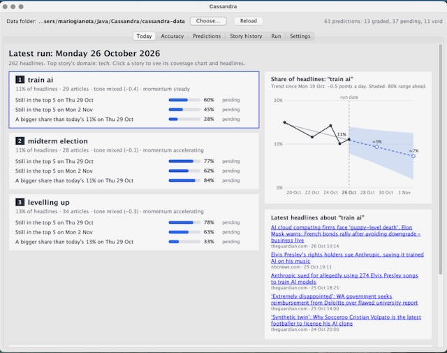
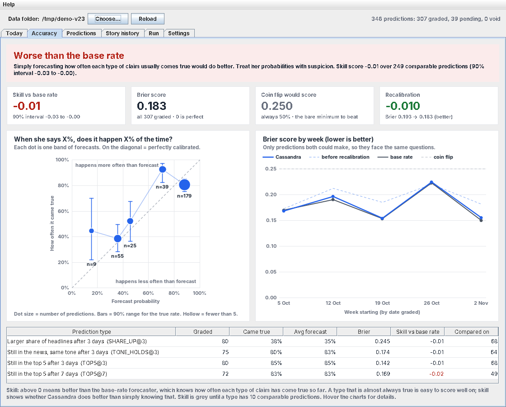
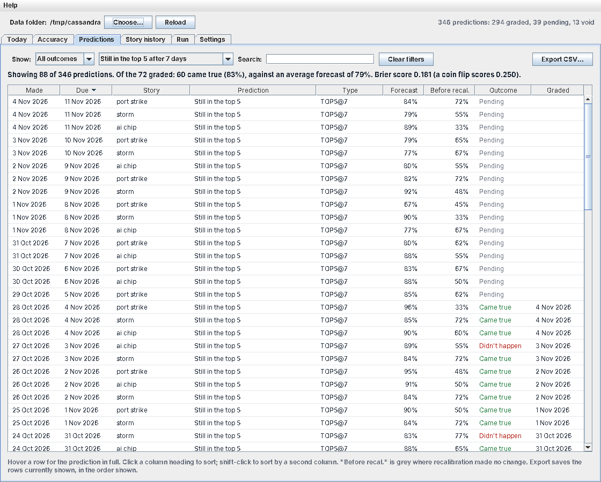
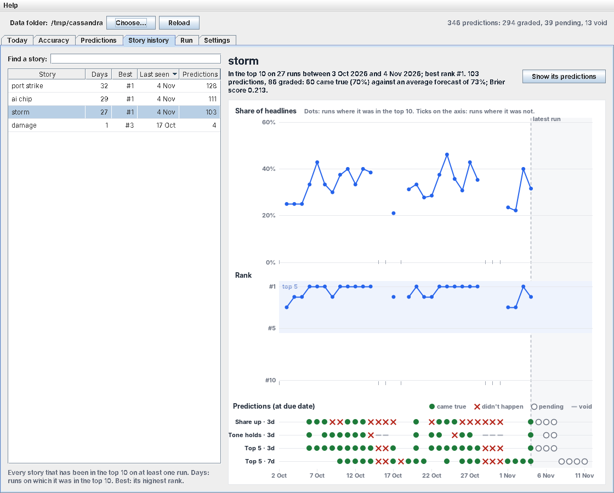
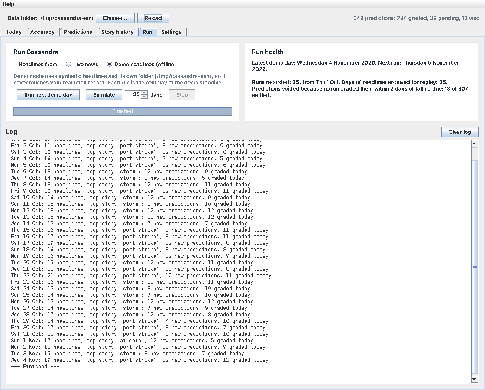
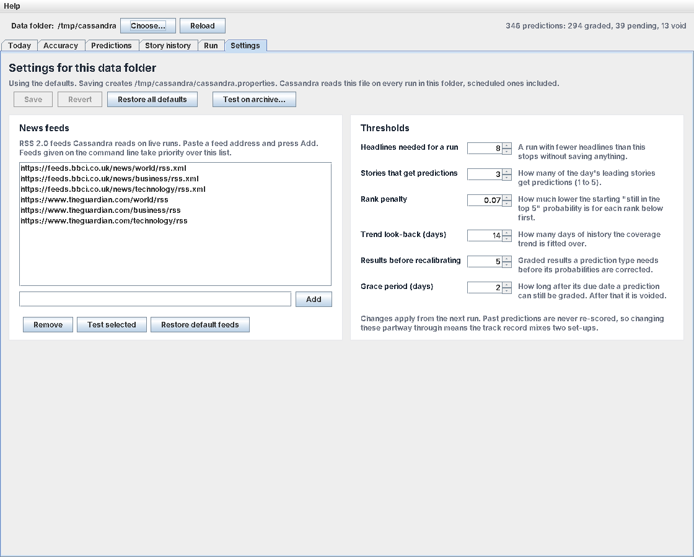
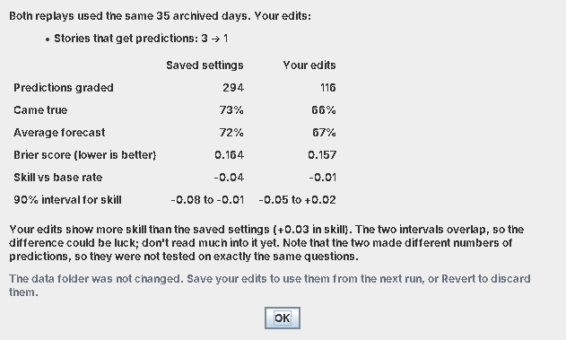
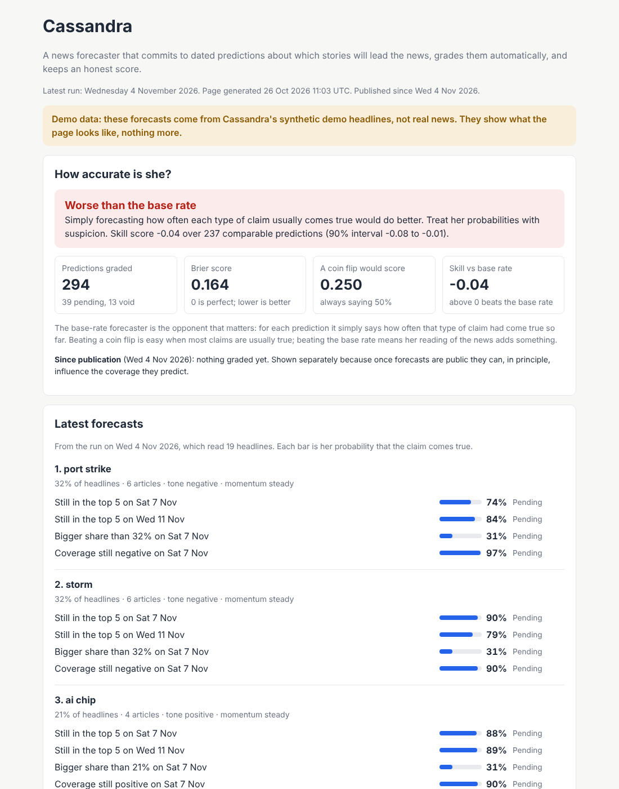

# Cassandra

**A news forecaster that makes predictions you can check, and keeps an honest score.**

Every day, Cassandra reads the headlines from the BBC and the Guardian, works out which stories are leading the news, and makes specific predictions about them, each with a probability. For example:

> *"By Saturday, the port strike will still be among the top five stories: 82%."*

A few days later she checks whether she was right, all by herself, and keeps a running score. That score is the point. Nobody can see the future, and Cassandra doesn't pretend to. What she can do is make claims you can test, and tell you plainly how often she gets them right.



*Cassandra's desktop window. This example uses real headlines.*

## Contents

1. [What Cassandra does](#what-cassandra-does)
2. [Is she any good?](#is-she-any-good)
3. [Getting started](#getting-started)
4. [The desktop window](#the-desktop-window)
5. [Running her every day](#running-her-every-day)
6. [Checking her accuracy](#checking-her-accuracy)
7. [Trying out changes safely](#trying-out-changes-safely)
8. [Publishing her forecasts](#publishing-her-forecasts)
9. [Commands at a glance](#commands-at-a-glance)
10. [What she can't do](#what-she-cant-do)
11. [Privacy and good manners](#privacy-and-good-manners)
12. [Plans](#plans)
13. [For developers](#for-developers)
14. [Licence](#licence)

## What Cassandra does

Each time she runs, Cassandra:

1. **Reads the news.** She fetches the latest headlines from news feeds (BBC and Guardian world, business and technology by default; you can choose your own).
2. **Finds the leading stories.** She counts which subjects appear most, across the most outlets, and in the most headlines, and ranks the day's stories.
3. **Measures them.** For each of the top three stories she works out its share of the day's headlines, its tone (positive, negative or mixed), and its momentum: is it getting more coverage than over the last few days, about the same, or less?
4. **Makes predictions.** Up to four dated predictions per story, each with a probability:

   | Prediction | Checked after |
   |---|---|
   | It will still be among the top five stories | 3 days, and again after 7 |
   | It will take a bigger share of the headlines than today | 3 days |
   | It will still be in the news, with coverage still clearly negative (or positive) | 3 days |

5. **Grades earlier predictions.** Any prediction that has fallen due is marked as *came true* or *didn't happen*, automatically. Nobody can change the outcome by hand.
6. **Learns from her record.** Each prediction starts from two things: her own first guess, and how often that kind of prediction has come true so far. At first her guess counts for most; as results come in, her record takes over. She also has clues, such as a story's rank, its momentum and how many days it has already lasted. But the clues have to earn their say: she records what they suggested each time, and only lets them move her once her record shows they've helped.
7. **Writes a short scenario** of what may follow for the top story. This is a hand-written template, not a prediction, and it's labelled as such.

Her predictions are about **news coverage** (what will be in the headlines), not about events themselves. "The port strike will still be a top story on Saturday" is something she can check; "the strike will end by Saturday" is not.

## Is she any good?

**On real news, not yet.** On 2 November 2026, after about two weeks of daily runs, she had 91 graded predictions, and on the 41 that can be compared she was doing **worse** than "what usually happens" (skill −0.22, margin of error −0.34 to −0.13). Her biggest weakness was clear: she expected stories to grow and change far more often than they did. She gave "this story will get a bigger share of the headlines" about a 50% chance, and it happened 25% of the time. Meanwhile she under-rated how often stories simply stay put.

Her report shows where that score comes from: 52 of those 53 predictions were her hand-set first guesses, made before she learned to start from her record. Versions 2.1 to 2.3 fix the problems the live record revealed. 2.1 rewrote those over-eager guesses. 2.2 fixed how she finds stories: a third of her "stories" were really newsletter adverts or everyday words. 2.3 stops her clues from misleading her: on real headlines they were pointing the wrong way. See [What changed](#what-changed-in-23).

**Replaying the same 12 days of real headlines** (25 October to 5 November) shows what each version would have done:

| Version | Brier score (lower is better) | Skill vs "what usually happens" |
|---|---|---|
| 2.1 | 0.288 | −0.07 (−0.14 to −0.02) |
| 2.2 | 0.267 | −0.05 (−0.16 to +0.05) |
| 2.3 | 0.256 | +0.02 (−0.03 to +0.08) |

Each version is better than the one before, and 2.3 is the first that isn't behind "what usually happens". But twelve days is far too short to call. She is still worse than a coin flip (0.250) on these days, mostly because "a bigger share of the headlines" remains hard for her. This section will be updated as the record grows.

What can be said is how she's judged, and that the test is deliberately hard to pass. Her predictions are compared with two simple opponents:

- **A coin flip** that always says 50%. This is easy to beat, because many of her claims are usually true. A forecaster that beats only a coin flip may know nothing at all.
- **"What usually happens."** This opponent simply says how often each kind of prediction has come true so far. For instance, if leading stories stay in the top five 85% of the time, it always says 85%. **This is the opponent that matters.** Beating it means Cassandra's reading of the news adds something beyond common sense.

Her score is a single **skill** number: above zero means she beats "what usually happens", zero means she's no better, and below zero means she's worse. It comes with a margin of error, and she won't give a verdict at all until there are enough results to be fair.

**On demo data:** over 35 demo days she beats a coin flip easily and is almost exactly level with "what usually happens" (skill −0.01, margin of error −0.03 to −0.00). Strictly, that's a measurable shortfall, but a tiny one: 0.184 against 0.181 on the Brier score. Level is the expected result, because the demo headlines are random draws following fixed storylines, so there's little to read beyond the usual patterns. Whether she can do better than common sense on real news is exactly what her live record will show.

### What changed in 2.3

- **Her clues have to earn their say.** Each prediction now records two probabilities: where she started (her record blended with her first guess), and where her clues (rank, momentum, trend, tone strength, days in the top five) would have taken her. Once results come in, she works out how much weight the clues would have deserved, and gives them that much and no more. On real headlines so far, the clues would have made every kind of prediction worse, so for now they have no say at all. In simulated news, where they do help, they had earned between a fifth and nine-tenths of a say after three months, depending on the kind of prediction. Her accuracy report has a new table showing how much say each kind of clue has earned.
- **A story that fades no longer escapes.** The tone prediction is now "it will still be in the news, with coverage still negative". Before, if a story had almost left the news, its tone prediction was quietly set aside as void, even though that's exactly when it was most likely to have failed. In simulated news, up to a third of tone predictions were being set aside this way. Tone predictions made before 2.3 keep their old rule.

### What changed in 2.2

- **Newsletter adverts are no longer news.** Guardian summaries carry promotions such as "Don't get Pushing Buttons delivered to your inbox? Sign up here". "Sign up" had become her most frequent story. These are now removed, including from headlines already in the archive, so replays benefit too.
- **Everyday words can't be stories.** Words such as "government", "state" and "time" turn up in many unrelated stories: "government" alone stood for six of them. Such words can still appear in a story's label, but can no longer *be* the story. The same goes for tone words such as "attack" or "deal", which describe a story rather than name it.
- **Amounts and contractions are read properly.** "$6.3bn" no longer produces a story called "bn", and "won't" no longer counts as the positive word "won".
- **Pending predictions are judged fairly.** A prediction is checked using the rules it was made under, so the new rules never rescore claims made before them.

### What changed in 2.1

- **Better first guesses.** A story is picked for being one of today's biggest, so it's usually near its peak, and more often shrinks than grows. Her first guesses now allow for that, and for the fact that big stories and their tone tend to last.
- **A smooth hand-over to her record.** Her first guess now counts as five results alongside the real ones. Before, she dropped it completely once a kind of prediction had five results, and then trusted a rate measured on just five.
- **She notices staying power.** How many days a story has already spent in the top five is now one of her clues.
- **She learns the right lesson from old mistakes.** Her guesses are corrected only by results from guesses made under the current rules. Otherwise, the old over-eager guesses would push the new, more cautious ones too far.
- **The report shows where the score comes from**, split by how each probability was set.

## Getting started

These steps are for a Mac. Cassandra also runs on Windows and Linux.

**1. Check that you have Java.** Open the **Terminal** app and type:

```bash
java -version
```

You need version 16 or later. If you get "command not found" or an older version, install a free Java, for example Eclipse Temurin from [adoptium.net](https://adoptium.net).

**2. Download Cassandra.** On the [GitHub page](https://github.com/RDMachinery/Cassandra), press the green **Code** button and choose **Download ZIP**, then unzip it. Cassandra is a single file, `Cassandra.java`.

**3. Try the demo.** In Terminal, go to the folder you unzipped (for example `cd ~/Downloads/Cassandra-main`) and run:

```bash
java Cassandra.java --demo
```

This uses made-up headlines, so it works without the internet and won't touch any real data.

**4. Open the window.**

```bash
java Cassandra.java --gui --demo
```

Go to the **Run** tab and press **Simulate** to run 35 demo days in a few seconds. Then look around the other tabs to watch her predictions being made and graded.

**5. Run her on the real news.**

```bash
java Cassandra.java
```

She reads today's headlines, makes her predictions and saves everything in a folder called `cassandra-data`. To build up a track record, run her once a day (see [Running her every day](#running-her-every-day)).

*Tip:* `java Cassandra.java` compiles the program each time it starts, which takes a few seconds. If you'd like it to start faster, run `javac Cassandra.java` once and then use `java Cassandra` instead.

## The desktop window

```bash
java Cassandra.java --gui
```

The window shows everything Cassandra knows, in six tabs. It updates by itself a few seconds after each daily run, so you can leave it open.

**Today** (pictured at the top of this page) shows what the latest run found: a card for each of the three leading stories with its predictions, a chart of how much coverage the selected story has had and where it's heading, and its latest headlines, which you can click to read. Click a card to choose a story; double-click it to see the story's whole history.

**Accuracy** answers "is she any good?" at a glance. A coloured banner gives the verdict: green if she's beating "what usually happens", red if she's worse, amber if it's too close to call, grey if it's too early to say. The chart on the left shows whether things she calls 70% likely really happen about 70% of the time.



**Predictions** lists every prediction she has ever made, with its outcome. You can sort it, filter it (for example to show only the predictions that didn't happen), search for a story, and save the list as a spreadsheet file. A line above the table shows how well she did on whatever is currently shown.



**Story history** follows one story over time: how much coverage it got each day, how high it ranked, and every prediction made about it, marked with a green dot if it came true or a red cross if it didn't.



**Run** lets you run Cassandra from the window. In **live** mode, **Run now** reads today's news. In **demo** mode, which uses a separate folder so it can never mix with your real record, you can run demo days one at a time or many at once. The **Run health** panel tells you when she last ran and whether any days were missed.



**Settings** is where you choose her news feeds (with a button to test that each one works) and adjust her thresholds, such as how many stories get predictions. Each setting has a short explanation. Settings are saved with your data and used by every run, including scheduled ones.



The window only changes your data when you press a run button or **Save**. On a Mac it will look slightly different from these screenshots, which were taken on Linux.

## Running her every day

A forecaster needs a daily record. On a Mac, the simplest way to run Cassandra automatically is with **cron**, the Mac's built-in scheduler.

1. In Terminal, compile Cassandra once in its folder: `javac Cassandra.java`
2. Type `crontab -e` to open your schedule, and add this line, using your own folder in place of `/Users/mario/cassandra`:

   ```
   0 7-23 * * *  cd /Users/mario/cassandra && (grep -q "^$(date -u +\%F)" cassandra-data/history.tsv 2>/dev/null || /usr/bin/java Cassandra >> cassandra.log 2>&1)
   ```

This checks every hour from 7am to 11pm and runs Cassandra the first time each day it finds she hasn't run yet. So if your Mac is asleep in the morning, she still runs later in the day. Each run's report is added to `cassandra.log`.

Two things to know:

- **The Mac must be awake at some point in the day.** If she misses a day, any prediction due that day can't be checked and is set aside as "void". The **Run** tab's health panel lists missed days.
- **Keep her folder outside Documents, Desktop and Downloads.** macOS stops scheduled jobs reading those folders unless you give them permission. A folder such as `~/cassandra` avoids the problem.

## Checking her accuracy

Any time, in Terminal:

```bash
java Cassandra --report
```

This prints a plain-English verdict first, followed by the detail: scores against the coin flip and "what usually happens", how each kind of prediction is doing, how she did depending on how each probability was set (her first guess alone, or her record), whether her 20% predictions come true about 20% of the time (and likewise for each band), and her score week by week. It only reads her saved predictions and never changes anything. The **Accuracy** tab in the window shows the same thing as charts.

## Trying out changes safely

Suppose you wonder whether Cassandra would do better making predictions about just the top story instead of three. You don't have to wait weeks to find out.

Every run keeps a copy of the exact headlines it read. Cassandra can **replay** those past days with different settings and show how she *would* have done, in a few seconds.

**In the window:** on the **Settings** tab, change a setting but don't save it yet, and press **Test on archive…**. She replays every archived day twice, once with your saved settings and once with your change, and compares the two:



She tells you honestly whether the difference is big enough to trust or could be down to luck. Nothing in your data changes until you press **Save**.

**In Terminal:** `java Cassandra --replay=cassandra-data` replays your archive into a separate folder and reports the result. See the [technical guide](TECHNICAL.md#replay) for testing different settings this way.

Replay also tests new versions of Cassandra. After upgrading, replay your archive into a new folder: you'll see how the new version would have done on exactly the headlines the old one saw.

## Publishing her forecasts

A forecaster can only be held to account if her predictions are public at the moment she makes them, before anyone knows the answer. Cassandra can turn her data into a small website:

```bash
java Cassandra --publish=site
```

This runs her as usual, then writes a website into a folder called `site`. The site shows her scorecard, today's forecasts and her charts, and offers an RSS feed and a downloadable file of every prediction she has ever made. That file comes with a "fingerprint" (a SHA-256 checksum) so anyone can confirm it hasn't been altered.



Cassandra only creates the files; she never posts or uploads anything herself. To put the site online for free, you can use **GitHub Pages**, and a scheduled job can publish it every day. Step-by-step instructions are in the [technical guide](TECHNICAL.md#publishing-on-github-pages).

**A caution.** Her predictions are about news coverage. If she ever became widely read, her forecasts could start to influence the coverage they predict, and her score would partly measure her influence rather than her foresight. So the website reports her accuracy since publication separately. For the same reason, she never posts, shares or promotes stories.

## Commands at a glance

| To do this | Type |
|---|---|
| Run her on today's news | `java Cassandra` |
| Try her with made-up headlines | `java Cassandra --demo` |
| Open the window | `java Cassandra --gui` |
| See her accuracy | `java Cassandra --report` |
| Replay past days into a separate folder | `java Cassandra --replay=cassandra-data` |
| Run, then write her website | `java Cassandra --publish=site` |
| Check that everything works | `java Cassandra --selftest` |
| List every option | `java Cassandra --help` |

Add `--data=FOLDER` to any of these to use a different data folder. If you haven't compiled her with `javac`, type `java Cassandra.java` instead of `java Cassandra`.

## What she can't do

- **She can't foresee events.** Her predictions are about what will be in the news, not about what will happen in the world.
- **The scenario is a template.** The "what may follow" text sounds plausible whatever happens, and it's never graded. Don't read it as a forecast.
- **Don't use her for decisions** about money, politics or safety.
- **She's only as good as her record shows.** With a short record her probabilities are rough, and early on they're educated guesses.
- **She sees what the outlets choose to publish.** News coverage reflects editors' decisions, not the importance of events.
- **Her language skills are basic.** She tracks stories by their key words, so a story can occasionally be split in two or mistaken for a new one, and two different stories that share a word can be treated as one. Her sense of tone is a simple word count that misses sarcasm and most negation.
- **She needs to run daily.** Missed days leave predictions that can't be checked.
- **English-language RSS feeds only.**

## Privacy and good manners

When she fetches a news feed, Cassandra sends only a standard request for that feed and introduces herself as `Cassandra News Forecaster - https://github.com/RDMachinery/Cassandra`, so the sites she reads can see what she is. She sends nothing about you, your computer or her predictions, and stores no cookies. She makes one request per feed per run. Please check the terms of use of any feed you add, and don't run her more than a few times a day.

## Plans

- **Test her methods on real news.** After a few weeks of daily runs, replaying the archive will show which clues really help, and which should be dropped.
- **Harder kinds of prediction**, such as "the leading story will still lead in three days" or "a fast-growing story just outside the top five will break into it".
- **More kinds of prediction**, such as "more outlets will be covering this story in three days".
- **Better story tracking**, so a story is followed correctly even when the words used to describe it change, and two stories that share a word ("midterm election", "Israel election") are kept apart.
- **Better "bigger share" predictions.** On real headlines this is her weakest kind of prediction: she can't yet tell which stories will grow.
- **Better clues.** Once her clues have a few weeks of real results, the report will show which ones help. The ones that never earn a say can be replaced with better ones.
- **Better tone reading**, so "not good" isn't counted as positive.
- **Support for Atom feeds** as well as RSS, and friendlier fetching that skips feeds that haven't changed.

## For developers

Cassandra is a single Java file with no external libraries. The [technical guide](TECHNICAL.md) covers how she works in detail: the scoring maths, every step of a run, the saved file formats, all settings and where to change things in the code, replay, publishing on GitHub Pages, and the full version history.

Issues and pull requests are welcome. Please check that `java Cassandra --selftest` passes, that a 35-day demo simulation still runs, and that `--report` on it is no worse than before.

## Licence

Written by Mario Gianota. Released under the MIT Licence; see `LICENSE` for details.
