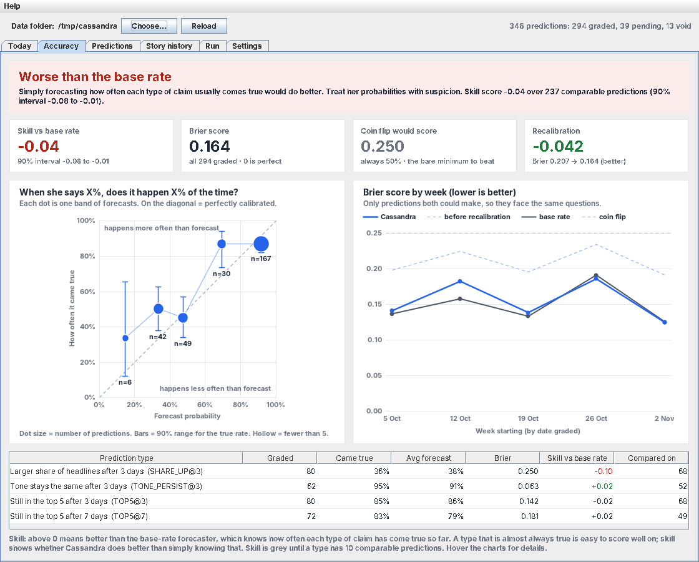
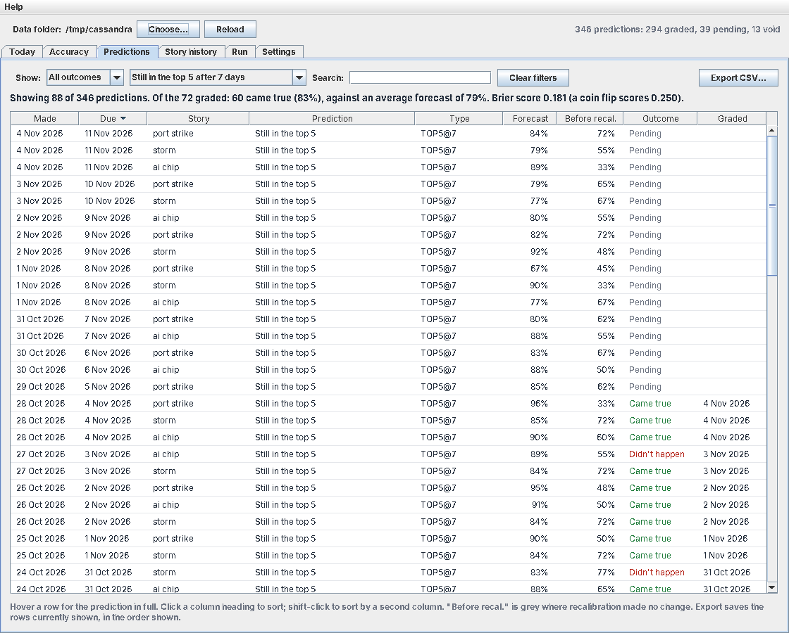
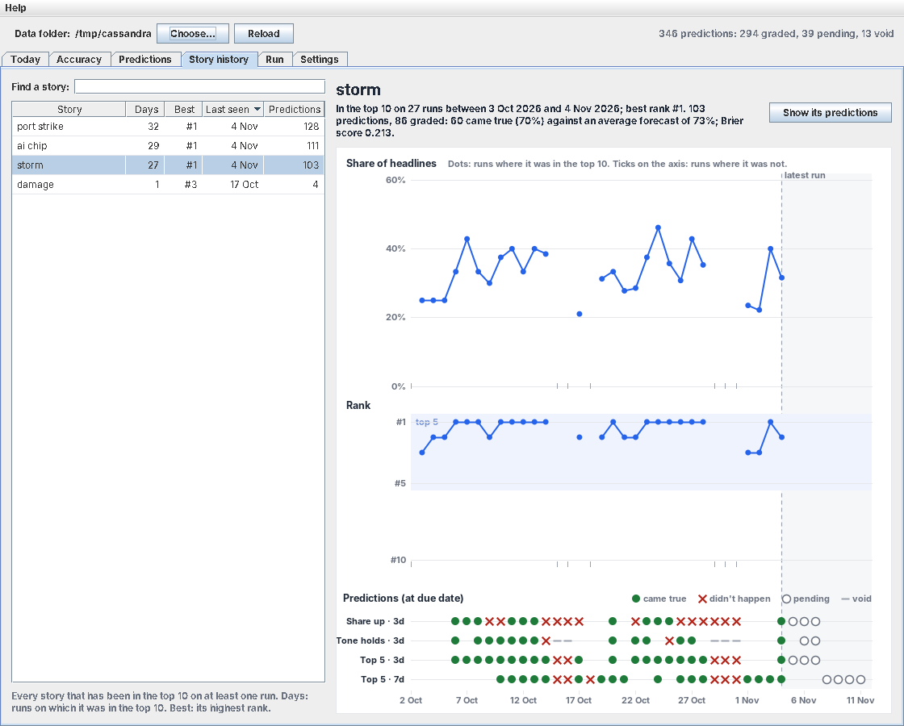
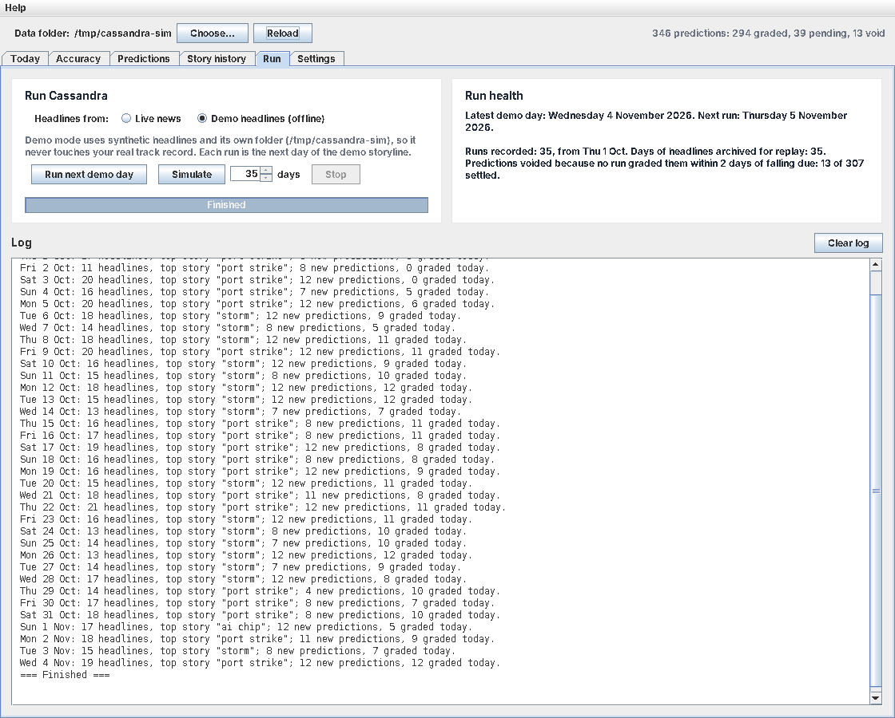
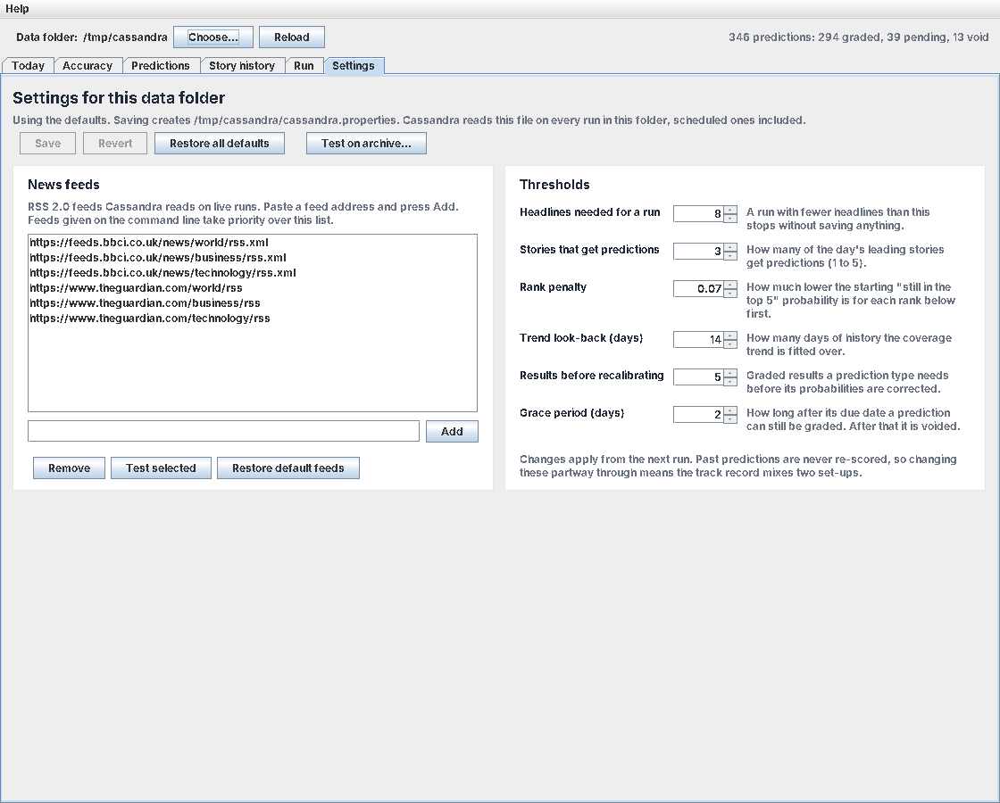
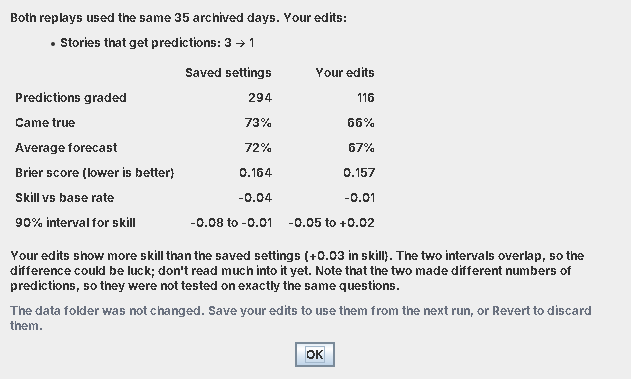
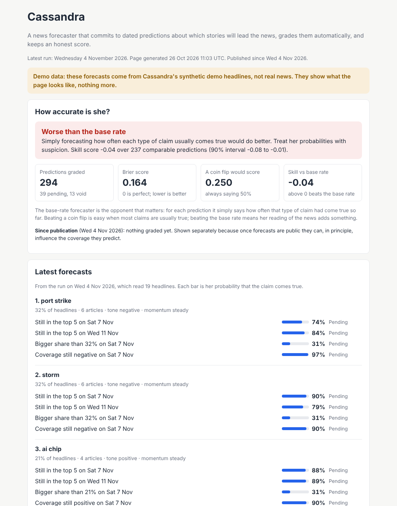

# Cassandra: technical guide

The detail behind the [README](../README.md): how Cassandra is scored, how a run works, the files she saves, every setting, the command-line options, replay, publishing, the self-test and the version history.

## Contents

1. [How she is scored](#how-she-is-scored)
2. [How a run works](#how-a-run-works)
3. [Command-line reference](#command-line-reference)
4. [Saved state](#saved-state)
5. [Settings and customising](#settings-and-customising)
6. [The desktop window in detail](#the-desktop-window-in-detail)
7. [Replay](#replay)
8. [Publishing on GitHub Pages](#publishing-on-github-pages)
9. [Self-test](#self-test)
10. [Known limitations](#known-limitations)
11. [Roadmap](#roadmap)
12. [Contributing](#contributing)
13. [Version history](#version-history)

## How she is scored

Every prediction is logged with the date it was made, its due date and its probability, then graded automatically when it falls due (see [How a run works](#how-a-run-works)). `java Cassandra --report` scores the whole record against three opponents:

| Opponent | What it does | Why it matters |
|---|---|---|
| **Coin flip** | Always says 50% | The bare minimum. Easy to beat, because many claims (such as "the leading story will still be in the top 5") are usually true. |
| **Base-rate forecaster** | For each prediction, says how often that type of claim had come true so far, using only results known on the day | **The opponent that matters.** Beating it means Cassandra's reading of the news adds something beyond "what usually happens". |
| **Herself, before recalibration** | Her hand-set first guesses, before the base rate and the evidence are applied | Shows whether learning from her record actually helps. |

Scores use the **Brier score**: the average squared gap between the probability given and what happened (1 if it came true, 0 if not). 0 is perfect, and always saying 50% scores 0.250.

The headline number is the **skill score**, `1 − Brier(Cassandra) / Brier(base rate)`. Above 0, she beats the base rate; 0 means no better; below 0 means worse.

To stop the report flattering her:

- **No verdict until there is evidence.** The base-rate forecaster needs 5 earlier results of a type before it makes a forecast, and the report gives no verdict until 30 predictions can be compared.
- **An honest margin of error.** The 90% interval on the skill score is bootstrapped by resampling *whole days*, because predictions made on the same day are about the same stories and tend to succeed or fail together.
- **Three possible verdicts:** she beats the base rate (the whole interval is above 0), she is worse (the whole interval is below 0), or she cannot yet be told apart from it.
- **Where she goes wrong.** A reliability table shows, for each band of forecasts (0–20%, 20–40% …), how often those claims actually came true.


### What the report looks like

Abridged output after 35 days of `--demo` runs (synthetic headlines, not real news):

```
THE SHORT ANSWER
  Cassandra is doing WORSE than simply forecasting how often each type of claim usually
  comes true. Treat her probabilities with suspicion.
  Skill score -0.04 over 237 comparable predictions (90% interval -0.08 to -0.01). 0 means
  no better than the base rate, 1 would be perfect, below 0 is worse.

BRIER SCORES (lower is better; 0 is perfect)
  All 294 graded predictions:
    Cassandra (issued probabilities)    0.164
    Cassandra before recalibration      0.207
    Coin flip (always 50%)              0.250
  The 237 predictions the base-rate forecaster could also make:
    Cassandra                           0.159
    Base-rate forecaster                0.153

BY PREDICTION TYPE
  type             graded  came true  avg forecast   Brier   skill vs base rate
  SHARE_UP@3           80        36%           38%   0.250   -0.10 (on 68)
  TONE_PERSIST@3       62        95%           91%   0.063   +0.02 (on 52)
  TOP5@3               80        85%           86%   0.142   -0.02 (on 68)
  TOP5@7               72        83%           79%   0.181   +0.02 (on 49)

RELIABILITY (when she says X%, does it happen X% of the time?)
  forecast  graded  avg forecast  came true  verdict
  0-20%          6           15%        33%  forecasts too low by 19 pts
  20-40%        42           34%        50%  forecasts too low by 16 pts
  40-60%        49           47%        45%  well calibrated
  60-80%        30           69%        87%  forecasts too low by 17 pts
  80-100%      167           92%        87%  well calibrated

BRIER SCORE BY WEEK (week starting, by date graded)
  week of      graded  Cassandra  before recal  Cassandra vs base rate
  2026-10-05      61      0.158         0.180  0.141 vs 0.136 (on 23)
  2026-10-12      69      0.192         0.226  0.182 vs 0.157 (on 55)
  2026-10-19      70      0.138         0.196  0.138 vs 0.133 (on 70)
  2026-10-26      61      0.186         0.234  0.186 vs 0.191 (on 61)
```

How to read this demo result:

- **She beats a coin flip easily** (0.164 against 0.250), which would look impressive on its own.
- **She is just short of the base rate** (skill −0.04), and the interval says this is not bad luck. That is the right answer for the demo: its headlines are random draws from a fixed set, so there is nothing to read beyond how often each kind of claim usually comes true. Starting every probability from the base rate brings her close to it; refining it by rank, momentum or trend can only add noise when there is no real signal. The report is not rigged in her favour.
- **`SHARE_UP` is still her weakest prediction** (skill −0.10). Day-to-day swings in a story's share of coverage are hard to call.
- **Learning from her record helps a lot:** her hand-set first guesses would have scored 0.207; the probabilities she actually issued scored 0.164.
- **For comparison, before probabilities started from the base rate** (and before the momentum fix) the same 35 days gave a skill of −0.17 and a Brier score of 0.178, with claims rated under 20% coming true 45% of the time.

Whether the evidence she uses (rank, momentum, trend, tone strength) carries real information can only be shown on real headlines. Replaying the archive after a few weeks of live runs will tell.

### Producing a real track record

```bash
# run daily, e.g. from cron, for four weeks or more
java Cassandra

# then
java Cassandra --report
```

`--report` only reads `predictions.tsv`; it fetches nothing and changes nothing, so you can run it as often as you like. `java Cassandra --gui` shows the same results as charts; see [The desktop window in detail](#the-desktop-window-in-detail).

## How a run works

1. **Gather.** Feeds are downloaded and parsed with the JDK XML parser (DOCTYPE disabled to block XXE). HTML and feed boilerplate ("Continue reading…") are stripped and duplicate headlines removed.
2. **Rank stories.** Words are tokenised, stopwords removed and plurals stemmed. Each term appearing in at least three articles scores `articles + 1.5 × (outlets − 1) + headline hits`. Terms whose articles overlap by more than 60% are merged into one story.
3. **Measure.** For each of the top 3 stories: tone is the average of (positive − negative lexicon words) per article, and momentum compares today's share of headlines with the story's average over the previous 3 days of runs (accelerating or fading needs a change of at least 3 points and 30%; a story absent from those runs is new). For the dominant story, the domain is the keyword lexicon with the most hits.
4. **Trend.** Each run saves the top 10 stories and their share of coverage. For each leading story, a least-squares line is fitted through its share from the first day it appeared in the top 10 (within the last 14 days) up to today, giving a projected share with a prediction interval. Days before it appeared are ignored; a day it drops out of the top 10 after appearing counts as a negligible share. At least 3 days of data are needed.
5. **Predict.** Up to four predictions are logged about each of the top 3 stories:

   | Type | Claim | Horizon |
   |---|---|---|
   | `TOP5` | It will still be among the top 5 stories | 3 and 7 days |
   | `SHARE_UP` | Its share of headlines will be higher than today | 3 days |
   | `TONE_PERSIST` | Its coverage will still be clearly negative (or positive); skipped when tone is mixed | 3 days |

   Each prediction records the evidence it was made on: rank and momentum for `TOP5`, the trend's direction (up, flat, down or none) and momentum for `SHARE_UP`, and tone strength for `TONE_PERSIST`. Its probability comes from the record:

   - **Once the type has 5 graded results,** it starts at the type's base rate (how often its claims have come true so far) and is refined through each piece of evidence in turn: the rate among earlier predictions that shared it, blended with the previous step as `(hits + 10 × previous) / (results + 10)`. Evidence that has made no difference so far moves nothing; evidence that has, moves the probability as far as its record supports.
   - **Before that,** her hand-set first guess is used (from rank, momentum, days in the top 5, tone strength, or the trend), recalibrated as below.
6. **Grade.** On the first run on or after a prediction's due date (within a 2-day grace period), it is marked true or false. Predictions that cannot be graded (for example, the story vanished before tone could be measured, or no run happened within the grace period) are voided and excluded from all scores.
7. **Calibrate.** Her first guess is always stored alongside the probability she issued, so the report can show what learning from her record has gained ("before recalibration"). While a type has too few results for the base rate, the first guess is recalibrated: her average forecast is compared with how often the claims came true and shifted in logit space to close the gap, weighted by `n / (n + 10)`.
8. **Score.** Each run's track record gives Brier scores per type and the skill score against the base-rate forecaster. `--report` adds the interval, verdict, reliability table and weekly scores described in [How she is scored](#how-she-is-scored).
9. **Narrate.** Hand-written causal templates for the dominant story's domain and tone are filled in for days, weeks and months, with the opposite tone offered as an alternative branch.

### Example output

Abridged output from the fourth run of the four-day loop in [Try the learning loop offline](#try-the-learning-loop-offline) (synthetic headlines, not real news):

```
COVERAGE FORECAST (share of headlines mentioning this story)
  Trend over 4 days of data (since 2026-10-01): -3.8 percentage points per day. Today 44%.
  In 3 days: about 27% (80% range 7%-47%)
  In 7 days: about 12% (80% range 0%-46%)

PREDICTIONS FOR THE TOP 2 STORIES (logged and graded when due)
  1. "port strike" - 44% of coverage
     - By 2026-10-07, "port strike" will still be among the top 5 stories.  -> 77%
     - By 2026-10-11, "port strike" will still be among the top 5 stories.  -> 62%
     - By 2026-10-07, "port strike" will take a larger share of headlines than on
       2026-10-04 (44%).  -> 23%
     - On 2026-10-07, coverage of "port strike" will still be clearly negative in tone.
       -> 72%
  2. "storm" - 25% of coverage
     - By 2026-10-07, "storm" will still be among the top 5 stories.  -> 70%
     - By 2026-10-11, "storm" will still be among the top 5 stories.  -> 55%
     - By 2026-10-07, "storm" will take a larger share of headlines than on 2026-10-04
       (25%).  -> 55%

GRADED TODAY
  - [CAME TRUE] By 2026-10-04, "port strike" will still be among the top 5 stories.
  (forecast 62%)
  - [DID NOT HAPPEN] By 2026-10-04, "port strike" will take a larger share of headlines
  than on 2026-10-01 (53%). (forecast 42%)
  - [DID NOT HAPPEN] By 2026-10-04, "ai chip" will still be among the top 5 stories.
  (forecast 55%)

CASSANDRA'S TRACK RECORD
  type             graded  came true  avg forecast  Brier (lower is better)
  SHARE_UP@3            2         0%           42%  0.176
  TONE_PERSIST@3        1       100%           72%  0.078
  TOP5@3                2        50%           59%  0.223
  Overall Brier score 0.176 over 5 graded predictions (a coin-flip forecaster scores
  0.250; a perfect one 0.000). Cassandra is currently beating a coin flip. Pending: 29.
  Too early to compare her with a base-rate forecaster (0 of 30 comparable predictions).
  Run with --report for details.
```

"Top 2" rather than 3 here because only two stories had enough coverage that day. This early on, no prediction type has 5 graded results yet, so these are her first guesses; later runs show `[from the base rate of …]` beside each probability.

## Command-line reference


```bash
java Cassandra                       # default feeds, state saved in ./cassandra-data
java Cassandra URL1 URL2 ...         # your own RSS feeds
java Cassandra --demo                # offline synthetic headlines (state in ./cassandra-demo-data)
java Cassandra --data=DIR            # keep history and predictions in DIR
java Cassandra --no-log              # analyse only; read and write nothing
java Cassandra --asof=2026-10-01     # pretend today is this date (demos and backtests only)
java Cassandra --report              # accuracy report from saved predictions; fetches nothing
java Cassandra --report --demo       # accuracy report for the demo data directory
java Cassandra --gui                 # desktop window for ./cassandra-data
java Cassandra --gui --data=DIR      # desktop window for another data directory
java Cassandra --gui --demo          # desktop window in demo mode
java Cassandra --replay=DIR          # replay DIR's archived headlines into DIR-replay
java Cassandra --replay=DIR --data=OUT   # ... into OUT, with OUT's cassandra.properties if any
java Cassandra --publish=SITE        # run, then write a static website of her forecasts into SITE
java Cassandra --publish-only=SITE   # write the website from saved results, without running
java Cassandra --publish=SITE --site-url=URL   # URL is the site's address, used in the RSS feed
java Cassandra --selftest            # run the built-in checks; exit status 0 if all pass
java Cassandra --help
```

**Requirements:** Java 16 or later; an internet connection for live feeds (not needed for `--demo`, `--report`, `--gui` or `--selftest`); a desktop session for `--gui` (everything else runs headless, e.g. from cron). Pure JDK: no Maven, no Gradle, no third-party libraries.

### Try the learning loop offline

`--demo` with `--asof` lets you watch predictions being made and graded without waiting a week:

```bash
for d in 2026-10-01 2026-10-02 2026-10-03 2026-10-04; do
  java Cassandra --demo --data=/tmp/cassandra --asof=$d
done
```

On 3 October the storm story appears and is marked "new today", with no trend fitted. The 4 October run grades the predictions made on 1 October.

To reproduce the accuracy report shown in [What the report looks like](#what-the-report-looks-like), run 35 days and then report:

```bash
for i in $(seq 0 34); do
  java Cassandra --demo --data=/tmp/cassandra --asof=$(date -d "2026-10-01 +$i day" +%F) > /dev/null
done
java Cassandra --report --data=/tmp/cassandra
```

(On macOS, use `date -v+${i}d -j -f %F 2026-10-01 +%F` in place of the `date -d` call.) Then open the same data in the window with `java Cassandra --gui --data=/tmp/cassandra`.

## Saved state

Plain-text files in the data directory (default `./cassandra-data`):

| File | Contents |
|---|---|
| `history.tsv` | date, term, rank, article count, total articles, net sentiment |
| `predictions.tsv` | id, made, due, term, label, kind, param, first guess, issued probability, outcome, resolved on, evidence (e.g. `r=2;m=steady;b=0.8500`: rank, momentum, and the base rate it started from; empty for older predictions) |
| `latest-run.tsv` | A snapshot of the latest run for the window's Today tab: one tagged line per item (`run`, `story`, `headline` with its link, `prediction`, `step`, `alternative`, `other`). Replaced on every run. |
| `cassandra.properties` | Optional settings for this folder: `feed.1`, `feed.2` … and `min.articles`, `predicted.stories`, `rank.penalty`, `history.days`, `calibration.min`, `grace.days`. Written by the Settings tab, with a comment on each line; you can also edit it by hand. Missing keys use the defaults. |
| `cassandra.lock` | An empty file that runs lock while saving, so two runs can't overwrite each other. Safe to ignore. |
| `archive/YYYY-MM-DD.tsv` | The headlines each saving run analysed: a `#ran` line with the run's time, then one line per headline (source, published, title, summary, link). Used by replay. Roughly tens of kilobytes a day with the default feeds. |

`predictions.tsv` is the complete track record: every prediction ever made, with its probability and outcome. It is plain text, so anyone can check the scores independently. `latest-run.tsv` is only for display; deleting it loses nothing that matters, and the next run writes a new one.

Delete the directory to reset Cassandra's memory. Re-running on the same day replaces that day's history rows and never duplicates predictions.

## Settings and customising

The feeds and the main thresholds can be changed without touching the code, per data folder, on the window's **Settings** tab or in `cassandra.properties` (see [Saved state](#saved-state)):

| Setting | Key in `cassandra.properties` | Default | Range |
|---|---|---|---|
| News feeds | `feed.1`, `feed.2`, … | BBC and Guardian world, business and technology | any RSS 2.0 feed |
| Headlines needed for a run | `min.articles` | 8 | 3–50 |
| Stories that get predictions | `predicted.stories` | 3 | 1–5 |
| How much lower the `TOP5` prior starts for each rank below #1 | `rank.penalty` | 0.07 | 0–0.2 |
| Trend look-back window (days) | `history.days` | 14 | 3–60 |
| Graded results needed before recalibrating | `calibration.min` | 5 | 2–50 |
| Grace period for grading (days) | `grace.days` | 2 | 0–7 |

Everything else lives in `Cassandra.java`:

| What to change | Where |
|---|---|
| Default settings (when a folder has no `cassandra.properties`) | `Settings.defaults()`, `DEFAULT_FEEDS` |
| Earlier results the base-rate forecaster needs (also when her own probabilities switch to starting from the base rate) | `BASE_WARMUP` |
| How strongly a group of predictions is pulled towards its parent's rate | `BASE_PRIOR_WEIGHT` |
| Days of runs that momentum compares today with | `MOMENTUM_DAYS` |
| The evidence each prediction type uses | `makePredictions` |
| Comparable predictions needed before `--report` gives a verdict | `MIN_FOR_VERDICT` |
| Bootstrap resamples for the skill-score interval | `BOOTSTRAP` |
| Comparable predictions before a type's skill is coloured in the window | `Gui.MIN_TYPE_SKILL` |
| The desktop window, its tabs and charts | the `Gui` class at the end of the file |
| Stopwords, sentiment and domain vocabularies | `STOP`, `NEG`, `POS`, `LEX` |
| First-guess priors and new prediction types | `makePredictions`, `resolve`, `statement` |
| Narrative templates | `chain(Domain)` |
| Demo headlines and storyline | `DEMO_PORT`, `DEMO_CHIP`, `DEMO_STORM`, `DEMO_FILLER`, `demoArticles` |

To add a prediction type, create it in `makePredictions`, grade it in `resolve`, and describe it in `statement`. Tracking, calibration, the accuracy report and the window pick it up automatically, for every leading story (give it readable wording in `Gui.describeType` and `Gui.shortStatement`).

The code is split so that calculating and showing never mix: `forecastRun` returns a `RunResult` and `computeAccuracy` returns an `Accuracy`; `printRun`, `printAccuracy` and the `Gui` only read those. A new view, such as JSON output, needs only a new reader.

## The desktop window in detail

The window opens on `./cassandra-data` (or the folder given with `--data=`, or `./cassandra-demo-data` with `--demo`). **Choose…** switches to another data folder and **Reload** re-reads it, though it also reloads by itself within a few seconds whenever a run saves new results. The window only writes to the folder when you press a run button on the Run tab or **Save** on the Settings tab; otherwise it just reads, so it is safe to leave open while cron runs Cassandra. **Help → About Cassandra** (on a Mac, also **Cassandra → About Cassandra**) shows the version, licence and the project's GitHub page.

#### Today tab

What the latest run found (see the screenshot at the top of the README). It reads `latest-run.tsv`, so it shows the most recent saved run, not live news.

| Part | What it shows | How to read it |
|---|---|---|
| Header | The date of the latest run and how many headlines it read | An amber warning appears if that run is 2 or more days old: check your scheduled job. |
| Story cards | The top 3 stories, each with its share of headlines, tone, momentum and predictions | The bar is her probability. The status on the right turns into "came true" or "didn't happen" once the prediction is graded. Click a card to select it; double-click to open its Story history. |
| Coverage chart | The selected story's daily share of headlines since it first appeared, the fitted trend, and the next 7 days | Dots are what happened. The dashed line and shaded band are the projection and its 80% range; the marked points are the 3- and 7-day forecasts. A new or young story has no trend yet. |
| Latest headlines | Up to 5 recent headlines about the selected story | Blue, underlined headlines open in your browser. |
| What may follow | The template scenario for the top story, and the other storylines to watch | Not a prediction and not graded: it reads plausibly whatever happens. |



#### Accuracy tab

From top to bottom:

| Part | What it shows | How to read it |
|---|---|---|
| Verdict banner | The same verdict as `--report`, with the skill score and its 90% interval | Green: beating the base rate. Red: worse. Amber: no clear edge. Grey: too early to judge. |
| Headline figures | Skill vs base rate, Brier score, what a coin flip would score, the effect of recalibration | Skill above 0 is good; Brier closer to 0 is good. A provisional skill score is shown in grey. |
| Reliability diagram | One dot per band of forecasts: average forecast (across) against how often those claims came true (up) | On the diagonal = well calibrated. Above it = things happen more often than she says; below = less often. Bars show a 90% range for the true rate; big dots hold more predictions; hollow dots have fewer than 5. |
| Brier score by week | Cassandra, Cassandra before recalibration, and the base-rate forecaster, week by week | Lower is better. Blue below grey = beating the base rate that week. Dashed above solid blue = recalibration helped. |
| Per-type table | Each prediction type's hit rate, average forecast, Brier score and skill | Skill turns green or red only once a type has 10 comparable predictions; below that it is grey, because it is mostly noise. |

Hover over a dot or a week for its exact numbers.

#### Predictions tab



Every prediction in `predictions.tsv`, as a table. The screenshot is filtered to one type, "Still in the top 5 after 7 days", and sorted by due date.

| Part | What it does |
|---|---|
| Filters | **Show** picks an outcome and a prediction type; **Search** matches the story, the wording or the type. **Clear filters** resets them. |
| Summary | For the rows shown: how many, how many have been graded, how many of those came true against her average forecast, and their Brier score. |
| Table | Click a heading to sort, shift-click a second heading to sort by both. Hover a row for the prediction in full. "Before recal." is grey where recalibration made no difference. |
| Export CSV… | Saves the rows shown, in the order shown, as a CSV file with the id, dates, story, type, short claim, full statement, both probabilities, outcome and grading date. |

The summary is a quick way to answer questions such as "how does she do on the storm story?" (search for it) or "does she over-rate tone predictions?" (pick that type). With few rows, treat its figures as rough.

#### Story history tab



One story's whole life. Pick it from the list on the left (type in **Find a story** to narrow it); the screenshot shows the demo's storm story.

| Part | What it shows | How to read it |
|---|---|---|
| Story list | Every story that has been in the top 10: runs spent there (**Days**), highest rank (**Best**), last seen, predictions made | Sort by any column. Only the top 3 stories each day get predictions, so some stories have none. |
| Summary | Its spell in the top 10, its best rank, and how her predictions about it fared | Hit rate against average forecast, and the Brier score, for this story alone. |
| Share of headlines | Its share of each run's headlines | Dots are runs where it was in the top 10, joined when those runs were consecutive. Ticks on the axis are runs where it was outside the top 10, where its share was not recorded. |
| Rank | Its position among the day's stories, #1 at the top | The shaded band is the top 5, which the `TOP5` predictions are about. |
| Predictions | Every prediction about it, one lane per type, at its due date | Green dot: came true. Red cross: didn't happen. Hollow circle: pending. Grey dash: void. The grey area to the right of "latest run" is the future, where everything is still pending. |

Hover any dot or marker for details. **Show its predictions** opens the Predictions tab filtered to this story.

Reading the bands together shows how her predictions relate to what happened. In the screenshot, the red crosses in the "Share up" lane tend to cluster a few days after the storm's coverage peaks: she expected it to keep growing, and it didn't.

#### Run tab



| Part | What it does |
|---|---|
| Headlines from | **Live news** works on your data folder. **Demo headlines** switches the window to the demo folder (`./cassandra-demo-data`, or the folder given with `--gui --demo --data=DIR`) so demo runs can never mix with your real track record. Switching back returns to the live folder. |
| Run now (live) | Fetches today's headlines from the feeds on the Settings tab and runs exactly as a scheduled run would. The full report appears in the log. Running twice on one day replaces that day's history; predictions already made that day are kept. |
| Run next demo day (demo) | Runs the day after the demo folder's latest day, so the storyline moves on. |
| Simulate N days (demo) | Runs N demo days in a row, one summary line per day, with a progress bar. **Stop** finishes the current day and stops. The screenshot shows 35 days from an empty folder. |
| Run health | When the latest run was, any days missed in the last 30 (live mode), how many predictions were voided because no run graded them within the grace period, and how many days of headlines are archived for replay. Missed days usually mean the scheduled job isn't running. |
| Log | Everything a run prints. **Clear log** empties it. |

While a run is going, the run buttons, the mode switch, **Choose…** and **Save** are disabled. If a scheduled run happens to be saving to the same folder at that moment, the window's run stops without saving and says so in the log.

#### Settings tab



Settings belong to a data folder and are saved in `cassandra.properties` there. **Every run in that folder reads them**: from the window, from the command line, and from cron.

| Part | What it does |
|---|---|
| News feeds | The RSS 2.0 feeds read on live runs. Paste an address and press **Add**; select feeds and press **Remove**; **Test selected** fetches them and reports how many headlines each returned (with nothing selected, it tests them all). **Restore default feeds** puts back the BBC and Guardian feeds. Feeds given on the command line take priority over this list. |
| Thresholds | Headlines needed for a run, stories that get predictions, rank penalty, trend look-back, results before recalibrating, and the grace period. Each has its allowed range and a one-line explanation. |
| Save / Revert / Restore all defaults | **Save** writes the file; **Revert** goes back to what is saved; **Restore all defaults** fills in the defaults (save to keep them). "Unsaved changes" stays visible until you save or revert, even when the window reloads. |
| Test on archive… | Before saving, see whether your edits would have done better: replays the archived headlines with the saved settings and with your edits, and compares them. See [Replay](#replay). |

Changes apply from the next run. Past predictions are never re-scored, so changing thresholds partway through means the track record mixes two set-ups. If you want a clean comparison, use a fresh data folder, or test the change on the archive first.

The window uses your system's look, so on a Mac it will look slightly different from these screenshots.

## Replay

Every run that saves also keeps the exact headlines it analysed in the data folder's `archive/`. Replay runs Cassandra over those archived days again, in order, into a fresh folder: the same dates, the same run times, the same headlines. With the original settings it reproduces the original track record exactly; with different settings it shows what *would* have happened. Weeks of grading take seconds.

### In the window

On the **Settings** tab, change one or more thresholds, then press **Test on archive…** (before saving). Cassandra replays the archive twice in temporary folders, once with the saved settings and once with your edits, and shows the results side by side:



The verdict compares the two skill scores against the base rate and says plainly when their intervals overlap, meaning the difference could be luck. Here, predicting for only the top story scored better, but not by enough to be sure on 35 days. Nothing in the data folder changes; **Save** your edits to use them, or **Revert** to discard them.

### On the command line

```bash
# baseline: replay with the folder's own settings into cassandra-data-replay
java Cassandra --replay=cassandra-data

# a variant: put the settings to try in a new folder, then replay into it
mkdir try-2-stories
echo "predicted.stories=2" > try-2-stories/cassandra.properties
java Cassandra --replay=cassandra-data --data=try-2-stories
```

Each replay prints one line per day, then the full accuracy report for the replayed folder and a comparison with the original runs. The replayed folder is an ordinary data folder, so you can also open it with `--report` or `--gui --data=…`. Replay refuses to write into a folder that already holds a track record.

What replay can and can't tell you:

- It tests **settings**: thresholds, and after code changes, priors and lexicons. It cannot test new feeds, since it only has the headlines that were archived.
- Changing the number of stories that get predictions changes **which** questions are asked, so the two sides are not graded on exactly the same predictions; the verdict says so when that happens.
- A setting tuned on the archive can fit its quirks. Treat a small improvement on a short archive as a hint, and check it again as the archive grows.

## Publishing on GitHub Pages

A forecaster can only be held to account, or be useful to anyone, if her predictions are public at the moment she makes them. `--publish` turns the data folder into a small static website:

```bash
java Cassandra --publish=site            # run as usual, then write the website into ./site
java Cassandra --publish-only=site       # write it from saved results, without running
```



| File | What it is |
|---|---|
| `index.html` | The scorecard (the same verdict as `--report`), the latest forecasts with probability bars and links to the stories, the reliability and weekly Brier charts, the 20 most recently graded predictions, and how to check it all. One self-contained page, no JavaScript, readable on a phone, light or dark to match the reader's system. |
| `feed.xml` | An RSS feed with one item per day of forecasts, so people can follow her in a feed reader. |
| `predictions.csv` | Every prediction she has ever made, with its probability, due date and outcome. |
| `predictions.sha256` | The CSV's SHA-256 fingerprint. Anyone can check a copy with `shasum -a 256 -c predictions.sha256`. |
| `since.txt` | The first day of publication. The scorecard reports accuracy since that day separately (see below). Leave it alone. |

Publishing writes files and nothing else: it does not post, upload or promote anything. Putting the folder online is your step.

**Demo data is labelled.** If the data comes from demo headlines, the page and the feed say so prominently, whether or not `--demo` was given.

### Putting it online

1. On GitHub, create an empty public repository, for example `cassandra-forecasts`.
2. Clone it as the site folder, next to your data: `cd ~/cassandra && git clone https://github.com/RDMachinery/cassandra-forecasts.git site`
3. In the repository's settings on GitHub, turn on GitHub Pages and serve it from the main branch's root folder. The site's address will be something like `https://rdmachinery.github.io/cassandra-forecasts/`.
4. Save this as `~/cassandra/publish.sh` and make it executable with `chmod +x publish.sh`:

   ```bash
   #!/bin/zsh
   # Run Cassandra, publish the website, and push it, recording the CSV's fingerprint in the commit.
   cd /Users/mario/cassandra || exit 1
   /usr/bin/java Cassandra --selftest > /dev/null || { echo "Self-test failed; not publishing."; exit 1; }
   /usr/bin/java Cassandra --publish=site --site-url=https://rdmachinery.github.io/cassandra-forecasts/
   cd site || exit 1
   git add -A
   git commit -q -m "Forecasts for $(date -u +%F); predictions.csv sha256 $(cut -c1-64 predictions.sha256)" && git push -q
   ```

5. Point your scheduled job at the script instead of at `java`. With the hourly catch-up pattern from the cron tutorial:

   ```
   0 7-23 * * *  cd /Users/mario/cassandra && (grep -q "^$(date -u +\%F)" cassandra-data/history.tsv 2>/dev/null || ./publish.sh >> cassandra.log 2>&1)
   ```

`git push` from cron needs to work without you typing anything, so set up an SSH key or a credential helper for GitHub first, and test with `./publish.sh` by hand.

**Why git matters.** Each day's commit is a public, timestamped record of exactly what she predicted, and the commit message carries the fingerprint of the full prediction file. Predictions can't be quietly changed later without that showing in the history.

### The catch: forecasts that influence what they forecast

Cassandra predicts news *coverage*. If she ever became widely read, her forecasts could change the coverage they predict: a story called "likely to stay big" might be kept big partly because of the forecast, or dropped because "everyone's covering it". Her score would then measure some of her influence as well as her foresight. So the page reports **accuracy since the first day of publication separately**, and the README's accuracy figures should say which period they cover. For the same reason, Cassandra never acts on the news herself: no posting, sharing or promoting stories, which would turn forecasting into manipulation and make her track record meaningless.

## Self-test

```bash
java Cassandra --selftest
```

Runs Cassandra's built-in checks and prints one line per check, ending with `All 17 checks passed`. It works offline, in a temporary folder that is removed afterwards, with the default settings, so it never touches your data and gives the same answer on any machine. The exit status is 0 if every check passes and 1 otherwise, so a script can stop before doing anything with a broken build (the [publish script](#putting-it-online) does exactly that).

| Check | What it guards |
|---|---|
| Brier score | The scoring formula, and the 0.25 a coin flip should get |
| Base-rate forecaster only uses results known at the time | The benchmark can't flatter itself with hindsight |
| Accuracy verdicts | A well-informed forecaster is judged "beating", a backwards one "worse", 20 results "too early"; the skill score sits inside its interval |
| Recalibration | No change on too few results; overconfidence pulled down, underconfidence pushed up |
| Trend fit | Slope and fitted value of an exact line, the spread's floor, no trend from two days |
| Trend starts on the day a story first appeared | Earlier days don't count as zero coverage |
| Momentum from daily history | Accelerating, steady, fading, new and unclear in the right cases |
| Probabilities start from the base rate | The base rate, the shrinkage of evidence groups, the warm-up, and no use of results not yet known |
| Grading | Came true, didn't happen, not yet due, void after the grace period, share and tone claims |
| Saving and loading predictions | Exact round trip, the evidence column, and older 11-column files |
| Settings file | Defaults with no file, exact round trip, out-of-range and garbled values ignored |
| Run lock | A second run is refused while one is saving, and the lock is released after |
| Reading an RSS feed | HTML and "Continue reading" removed, links and dates read, blank items skipped, missing dates handled, a feed with a DOCTYPE (an XXE attack) refused |
| Duplicates, wrapping, CSV quoting | Small text utilities behave |
| Headline archive round trip | Archived headlines, links and run time come back exactly |
| End to end | Six demo days produce every file, grade predictions, record evidence, and replay reproduces them byte for byte |
| Publishing | Every file written, the fingerprint matches, the RSS parses, demo data labelled, every prediction in the CSV |

It does not test the desktop window (that needs a screen) or fetch live feeds. To check that the checks themselves work, ten realistic bugs were each introduced on purpose; every one made the self-test fail with the right check named.

## Known limitations

- **It cannot foresee events.** The predictions are about news coverage (what will be in the headlines, how big it will be, what tone it will have), not about the underlying events. The narrative is template-based and will sound plausible whatever the facts. Do not use any of it for financial, political or safety decisions.
- **No live track record yet.** The only accuracy figures so far come from synthetic demo data.
- **Early probabilities are guesses.** Until a prediction type has 5 graded results she uses hand-set first guesses, and with only a handful of results both her probabilities and the track record are statistically noisy.
- **The interval is approximate.** Resampling by day allows for predictions on the same day being linked, but not for links across days (the same story is predicted about on several days running), so the true uncertainty is somewhat wider.
- **Small groups learn slowly.** Rank and momentum are learned from the record, but a group with few results stays near the type's base rate, so real differences take a few weeks to show; and on short records the groups can disagree in odd ways (a 7-day forecast higher than the 3-day one).
- **A cold start takes time.** No trend appears until three different days have been recorded, the first grades arrive three days after the first run, and a verdict needs a few weeks.
- **Story identity can drift.** A story is tracked by its top-ranked term; if the leading word changes from day to day, history for that story may be split, and it may be treated as new.
- **Sentiment is crude.** A small word list cannot handle negation or sarcasm.
- **Coverage is not reality.** Feeds are editorial selections, and the result reflects what these outlets chose to publish.
- **Changing settings mid-record mixes set-ups.** Past predictions keep the settings they were made under, so the track record after a change blends two configurations. Test a change on the archive first.
- **Replay only knows archived headlines.** Archiving starts with version 2.0, it can't test feeds that weren't being read, and settings tuned on a short archive may not hold up on new days.
- **Published forecasts can influence what they forecast.** If the site became widely read, her score could partly reflect her influence on coverage rather than her foresight; accuracy since publication is reported separately for that reason.
- **Only RSS 2.0 `<item>` feeds are supported; English only.**

## Roadmap

Planned features, roughly in priority order. None of these are implemented yet.

### Better learning

- **Test the evidence on real headlines.** After a few weeks of live runs, replay the archive to see which evidence (rank, momentum, trend, tone strength) actually carries information, and drop or add evidence accordingly.
- **New prediction types.** For example `DROP_OUT` (the story leaves the top 10 within 7 days) and `OUTLETS_UP` (more outlets covering it in 3 days).
- **HTML accuracy report.** The window's charts as a self-contained HTML page, for sharing the track record.

### Smarter analysis

- **Stable story identity.** Match today's stories to yesterday's by overlap of their top terms, not by a single leading word, and give each story a persistent ID in `history.tsv`.
- **Negation-aware sentiment.** Flip the polarity of a lexicon word preceded within two words by "not", "no", "never", "without" and similar.
- **Bigram story labels** used as the tracked key, so "port strike" and "general strike" are not the same story.

### Practicalities

- **Atom feed support** (`<entry>` elements) alongside RSS 2.0.
- **Polite fetching.** Send `If-Modified-Since` / `ETag` headers and skip unchanged feeds.
- **Machine-readable output (`--json`)** for dashboards or other tools.
- **LLM narrative (optional).** Replace the template narrative with a model call that receives the clustered headlines and Cassandra's track record, while keeping the templates as an offline fallback.

## Contributing

Issues and pull requests are welcome. If you change priors, lexicons or templates, include a short before/after example in the PR description, ideally with `--report` output from the same data before and after. Please run `java Cassandra --selftest` first, and add a check for anything new.

## Version history

### Version 2.0

#### Self-test (`--selftest`)

`java Cassandra --selftest` runs 17 built-in checks in under a second and prints PASS or FAIL for each. See [Self-test](#self-test).

- **Offline and harmless:** everything runs in a temporary folder that is deleted afterwards, with default settings; your data, settings and feeds are never touched
- **Exit code 0 if all pass, 1 if any fail,** so scripts can rely on it; `publish.sh` now refuses to publish if a check fails
- **Proven to catch bugs:** ten deliberate bugs were introduced one at a time, including the old momentum bug and a base-rate forecaster that peeks at future results, and every one was caught by the check you'd expect
- Feed parsing is now separate from downloading, so it can be tested without the network, and a malformed feed no longer prints a parser error to the log

#### Momentum fixed, and probabilities start from the base rate

Two changes to how she forecasts, and a courtesy to the sites she reads.

- **Momentum now measures what it says.** It used to compare articles from the last 8 hours of one fetch with the 24 hours before. Feeds mostly carry recent items, so the earlier window was nearly always thin and momentum read "accelerating" on every one of 35 demo runs. That quietly added 10 points to every "still in the top 5" forecast. Momentum now compares a story's share of headlines today with its average over the previous 3 days of runs, and must change by at least 3 points and 30% to count as accelerating or fading. A story missing from those runs is **new**; with no runs to compare against, momentum is **unclear**. On the same 35 demo days the dominant story was now steady 22 times, accelerating 11, fading once and unclear once. The report shows the numbers behind it, e.g. `Momentum: steady (33% of headlines today against 34% on average over the previous 3 days)`.
- **Every probability starts from the base rate.** Once a prediction type has 5 graded results, a new prediction begins at how often that type has come true so far, then moves only as far as the record shows its evidence matters: rank and momentum for "still in the top 5", the trend's direction and momentum for "bigger share", and the tone's strength for "tone holds". Each step blends a group's own rate with the step before it, `(hits + 10 × parent) / (results + 10)`, so a group with few results stays close to the base rate. Her old hand-set probabilities are now only her first guesses, used while a type has no record.
- **Each prediction records its evidence** in a new last column of `predictions.tsv` (for example `r=2;m=steady;b=0.8500`), which is what lets later predictions learn from it. Older files load unchanged.
- **The report shows where each probability came from**, e.g. `-> 86% [from the base rate of 88%; first guess 87%]`.
- **Results on the same 35 demo days:** skill against the base rate improved from −0.17 to −0.04, the Brier score from 0.178 to 0.164, and the weakest type (`SHARE_UP`) from −0.28 to −0.10. She is still slightly short of the base rate, which is expected on demo data, where there is no real signal for the evidence to find. Real headlines and the replay archive will show whether it helps.
- **User-Agent** is now `Cassandra News Forecaster - https://github.com/RDMachinery/Cassandra`, so the sites she reads can see what she is and where to find out more.
- Replay still reproduces runs exactly with the new code.

#### Publishing (`--publish`)

Her forecasts can now be made public and verifiable from the moment they're made. See [Publishing her forecasts](#publishing-on-github-pages).

- **`--publish=SITE`** runs as usual, then writes a static website into SITE; **`--publish-only=SITE`** writes it from saved results without running
- **`index.html`:** the scorecard, the latest forecasts with links to the stories, the reliability and weekly Brier charts, recently graded predictions, and how to check it all. One self-contained page with no JavaScript, readable on a phone and in dark mode.
- **`feed.xml`:** an RSS feed, one item per day of forecasts
- **`predictions.csv` and `predictions.sha256`:** every prediction ever made, and its fingerprint for anyone to check
- **Accuracy since publication is shown separately,** because public forecasts can influence the coverage they predict
- **Demo data is labelled** on the page and in the feed, even if `--demo` wasn't given
- **Nothing is posted anywhere.** Publishing writes files; the [publishing section](#putting-it-online) shows how to put them on GitHub Pages and push them daily from cron, with the fingerprint in each commit message

#### Headline archive and replay

Settings changes can now be tested against real past headlines in seconds, instead of waiting weeks for new grades. See [Testing changes with replay](#replay).

- **Every saving run archives the headlines it analysed**, together with the moment it ran, in `archive/YYYY-MM-DD.tsv` inside the data folder. Re-running a day replaces that day's file.
- **`--replay=DIR`** re-runs Cassandra over DIR's archive, day by day, into a fresh folder (`--data=OUT`, default `DIR-replay`), using the settings in that folder's `cassandra.properties` if it has one. It then prints the accuracy report and a comparison with the original runs.
- **Exact:** each day replays with the same date, run time and headlines, so with the original settings a replay reproduces the original track record byte for byte. This was checked on 35 days of demo runs and on a live run with real article links.
- **Safe:** replay refuses to write into a folder that already holds a track record, so two records can never be mixed.
- **Test on archive…** on the Settings tab replays the archive twice, once with the saved settings and once with your unsaved edits, and shows the two side by side with an honest verdict: if the skill intervals overlap, it says the difference could be luck. Nothing in the data folder changes.
- **Run health** on the Run tab now also says how many days of headlines are archived.

The archive starts with this version: folders from earlier versions have nothing to replay until they have run a few more times.

#### Run and Settings tabs

The last two desktop-window items from the roadmap. The window can now run Cassandra and change her settings, not just show results. See [Run tab](#run-tab) and [Settings tab](#settings-tab).

**Run tab**

- **Run now** fetches today's headlines and runs exactly as a scheduled run would, with the full report in a live log
- **Demo mode** switches the window to the separate demo folder (`./cassandra-demo-data`, as with `--demo`), so demo runs never touch your real track record. There, **Run next demo day** advances the demo storyline by a day, and **Simulate N days** runs many days in one go, with a progress bar and a Stop button.
- **Run health:** the date of the latest run, any **days missed** in the last 30 (so you can spot a broken scheduled job), and how many predictions were voided because no run graded them in time

**Settings tab**

- **News feeds:** add, remove and test feeds (testing shows how many headlines each one returns), or restore the defaults
- **Thresholds:** headlines needed for a run, stories that get predictions, rank penalty, trend look-back, results before recalibrating, and the grace period, each with a one-line explanation
- **Save** writes them to `cassandra.properties` in the data folder. **Every run in that folder uses them, scheduled ones included**, so nothing needs recompiling. Unsaved edits are kept through the automatic reload.

**Behind the scenes**

- **Settings file.** `cassandra.properties` holds the feeds and thresholds for its folder, and is plain text you can also edit by hand. Values out of range are reported and ignored. With no file, everything works exactly as before. Feeds given on the command line still take priority.
- **Run lock.** A run now holds a lock on its data folder (`cassandra.lock`) while it reads and saves. If a scheduled run and a run from the window ever overlap, the second stops without saving and says so, instead of the two overwriting each other.
- Checked: with no settings file, terminal output and saved data are unchanged over 35 days of demo runs; and 35 days simulated in the window produce data identical to 35 separate command-line runs.

#### Story history tab

A fourth tab in the desktop window: pick any story Cassandra has tracked and see its whole life on one timeline. See [Desktop window](#story-history-tab) for a tour.

- **A searchable list of every story** that has been in the top 10, with how many runs it spent there, its best rank, when it was last seen and how many predictions it drew
- **A summary for the chosen story:** its spell in the top 10, its best rank, and how her predictions about it fared (hit rate against average forecast, and Brier score)
- **One timeline in three bands sharing a date axis:**
  - its **share of headlines**, run by run, with gaps where it dropped out of the top 10
  - its **rank**, with the top 5 shaded, since that is what the `TOP5` predictions are about
  - **every prediction made about it**, one lane per type, marked at its due date: came true, didn't happen, pending or void
- **Hover** any dot or marker for its figures, or a prediction for its full wording, forecast and outcome
- **Show its predictions** opens the Predictions tab filtered to that story
- **Double-click a story on the Today tab** to jump straight to its history
- The chosen story and any search **survive the automatic reload** after a scheduled run

#### Predictions tab

A third tab in the desktop window: the complete ledger of every prediction Cassandra has made. See [Desktop window](#predictions-tab) for a tour.

- **One row per prediction:** when it was made and due, the story, what it claims, its type, the probability she gave (and before recalibration), the outcome and when it was graded
- **Sort by any column**; shift-click a second heading to sort by two
- **Filter** by outcome (pending, came true, didn't happen, void), by prediction type, or by searching for a story or word
- **A live summary of what's shown:** how many came true against her average forecast, and the Brier score. Filter to one type or one story to see how she does on just that.
- **Export CSV** saves the rows currently shown, in the order shown, with the full wording of each prediction
- **Filters and sort order survive** the automatic reload after a scheduled run
- **Read-only:** outcomes can be inspected and exported, never edited
- **About box:** Help → About Cassandra (on a Mac, also in the Cassandra menu) shows the version, licence and GitHub page

#### Today tab

The desktop window now opens on a **Today** tab showing what the latest run found. See [The desktop window in detail](#the-desktop-window-in-detail) for a tour.

- **A card for each of the top 3 stories**: share of headlines, article count, tone and momentum, with a "new today" badge for stories that have just appeared
- **Each story's predictions** with a probability bar, and their outcome once graded (pending, came true, didn't happen or void). Hover a prediction for its full wording, or a bar to see whether recalibration changed it.
- **Coverage chart** for the selected story: its daily share of headlines since it first appeared, the fitted trend, and the projection 7 days ahead with its 80% range
- **Latest headlines** for the selected story. Click one to open the article in your browser.
- **The scenario narrative** for the top story, clearly labelled as an ungraded template rather than a prediction, plus the other storylines to watch
- **A warning when the latest run is 2 or more days old**, since missed runs void predictions
- **Click a card** to switch the chart and headlines to that story

To make this possible without the window fetching or writing anything:

- **Each run saves a snapshot** of what it found to `latest-run.tsv` (see [Saved state](#saved-state)). It is replaced on every run and written safely, like the other files.
- **Article links are kept.** Cassandra now reads each feed item's `<link>`, so headlines can be opened. Demo headlines have no links.

Terminal output, `history.tsv` and `predictions.tsv` are unchanged; checked against 35 days of demo runs.

#### Desktop window (`--gui`)

A Swing window that shows Cassandra's accuracy as charts instead of text, on its **Accuracy** tab:

- **Verdict banner** in green, red, amber or grey: beating the base rate, worse than it, no clear edge, or too early to judge
- **Headline figures**: skill against the base rate with its interval, Brier score, what a coin flip would score, and what recalibration has gained
- **Reliability diagram**: forecast probability against how often it came true, with a 90% range for each band
- **Brier score by week** for Cassandra, Cassandra before recalibration and the base-rate forecaster, with the coin-flip line for reference
- **Per-type table**, with skill shown in colour once a type has enough comparable predictions
- **Hover** over a dot or a week for its exact figures
- **Reloads by itself** when a scheduled run saves new results while the window is open
- **No way to change past outcomes**: the window can now run Cassandra and save settings (see the Run and Settings tabs), but grading is always automatic

#### Under the hood

- **The engine is separate from the printing.** A run now produces a result object (`forecastRun` → `RunResult`), and so does the accuracy report (`computeAccuracy` → `Accuracy`). The terminal printers and the GUI only read these. Terminal output and saved files are byte-for-byte unchanged; this was checked against 35 days of demo runs.
- **Safe saves.** `history.tsv` and `predictions.tsv` are written to a temporary file and then renamed into place, so anything reading them, such as the window, never sees a half-written file.

#### Earlier in this release

- **Accuracy report (`--report`).** Skill score against a base-rate forecaster with a 90% interval and a plain-English verdict, Brier scores against three benchmarks, a per-type breakdown, a reliability table and weekly Brier scores. The end-of-run track record also gives the skill score. See [How accurate is she?](#how-she-is-scored).
- **Predictions for the top 3 stories.** Each of the top 3 stories gets its own predictions, so about three times as many are graded each day and recalibration starts within the first week. Lower-ranked stories start with a lower `TOP5` probability (the `rank.penalty` setting).
- **Fair trends for new stories.** The trend is fitted only from the day a story first appeared in the top 10, instead of counting the days before as 0% coverage. New stories are labelled "new today", and the forecast explains when there is not yet enough data for a trend.
- **Livelier demo.** `--demo` headlines change from day to day: a fading port strike, a steady AI chip story, and a storm that breaks on 3 October and grows.
- **Tidier output.** Wrapped prediction lines have a hanging indent.

Existing `history.tsv` and `predictions.tsv` files work unchanged.
